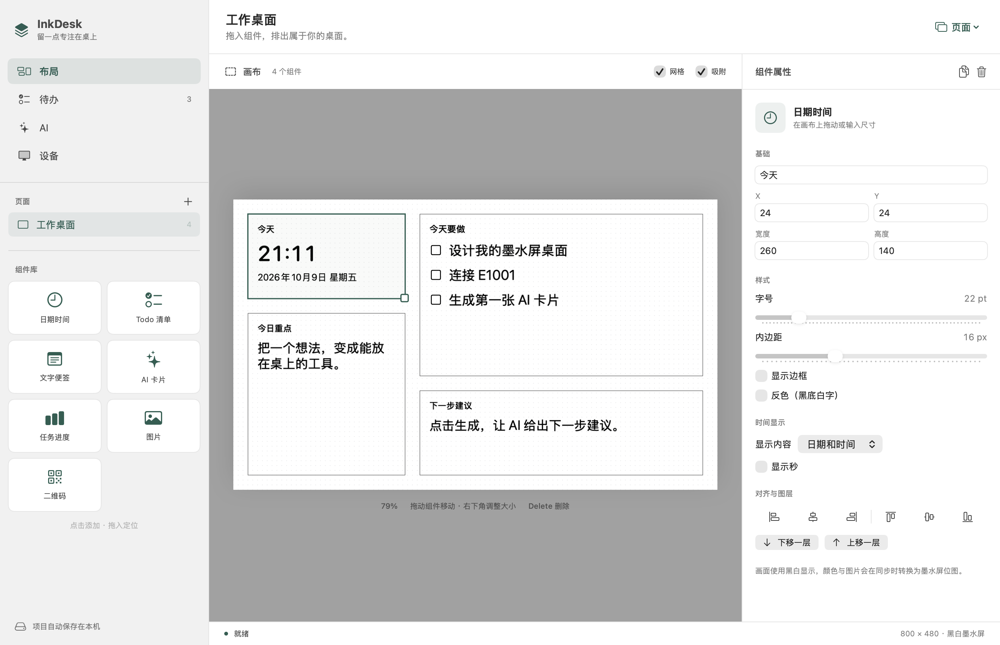

# InkDesk

为 Seeed reTerminal E1001 制作桌面内容的原生 macOS 应用。把时钟、待办、便签、图片和 AI 卡片排成一张 800×480 的黑白画面，再通过局域网同步到墨水屏。也可以只在 Mac 上编辑并导出图片。



## 功能

- **布局编辑**：拖入组件、移动和调整尺寸，支持网格吸附、对齐、图层、页面复制、撤销和重做。
- **七种组件**：日期时间、Todo 清单、文字便签、AI 卡片、任务进度、图片、二维码。
- **待办管理**：任务项目、优先级、截止日期与完成状态；Todo 和进度组件共用任务数据。
- **可选 AI**：连接自己选择的兼容 API，生成卡片内容或任务拆解草稿；确认草稿后再加入 Todo。
- **设备同步**：编辑合并、固定传输画面、刷新回执、失败重试；设备按键可以切页和操作任务。
- **菜单栏运行**：收起主窗口后继续提供同步服务，从顶部菜单栏恢复窗口、同步或退出。
- **导入导出**：项目文件、800×480 黑白 PNG，以及 48,000 字节的设备位图 BIN。

最多支持 24 个页面；设备每页最多操作 96 项任务，可通过 Todo 组件的项目过滤控制范围。

## 兼容性

| 项目 | 要求或当前范围 |
|---|---|
| Mac | macOS 14 或更新版本；实际验证环境为 Apple Silicon、macOS 26 |
| 构建工具 | Xcode 或包含 Swift 编译器及 macOS SDK 的 Apple Command Line Tools |
| CPU 架构 | 构建脚本使用当前 Mac 架构；Intel Mac 尚未实测 |
| 墨水屏 | Seeed reTerminal E1001，ESP32-S3 / UC8179 / 800×480 黑白屏 |
| 固件工具 | ESP-IDF 6.0.1 已验证；其他版本需自行检查构建兼容性 |
| 网络 | Mac 与设备处于互通的局域网；E1001 使用 2.4 GHz Wi-Fi |
| 供电 | 当前固件常驻联网并全屏刷新，建议 USB 供电 |

Seeed 出厂固件不会自动连接 InkDesk，需要编译并烧录本项目固件。其他屏幕型号、彩色面板和厂商云服务不在当前支持范围。

## 开始使用

本仓库提供源码，尚未发布预编译 App。先在 Mac 安装构建工具，再从仓库根目录构建：

```sh
git clone https://github.com/Yyang212/InkDesk.git
cd InkDesk
./build.sh
open InkDesk.app
```

如果尚未安装 Command Line Tools，可先运行 `xcode-select --install`。也可以用 Xcode 打开 [InkDesk.xcodeproj](InkDesk.xcodeproj)，选择 InkDesk scheme 并运行。

1. 在“布局”中点击或拖入组件。拖动卡片改变位置，通过右下角手柄调整尺寸，右侧修改内容与样式。
2. 在“待办”中添加任务并设置项目、优先级和截止日期。
3. 如需 AI，在“AI”中填写自己的接口地址、模型、接口格式和密钥，保存后测试连接。
4. 如需墨水屏，在“设备”中启动同步服务，记录 Mac 的局域网地址、端口和设备配对密钥，按[固件说明](docs/firmware.md)配置和烧录 E1001。
5. 点击“立即同步”，查看待同步、本次同步和已确认画面。首次设备刷新回执之前，显示状态为“未确认”。

本地构建使用 ad-hoc 签名，未提供 Developer ID 签名或公证。首次使用或重新构建后，macOS 可能询问钥匙串访问权限；在系统提示中完成授权即可，等待期间仍可编辑布局与任务。

## 菜单栏与后台运行

按 ⌘M、点击黄色最小化按钮，或按 ⌘W / 点击红色关闭按钮，会收起主窗口并保留顶部菜单栏的 InkDesk 图标；此时 App 继续运行，Dock 图标隐藏。选择菜单栏中的“打开 InkDesk”可恢复编辑窗口。

菜单可查看服务与同步状态、待同步和传输数量、立即同步，以及启动或停止服务。选择“退出 InkDesk”或在 App 前台按 ⌘Q 才会退出并停止服务。

后台同步需要已启动的服务、保持唤醒的 Mac，以及设备能够访问的网络。收起窗口不会自动启动服务；如需每次启动 App 时开启服务，可在设备设置中启用对应选项。Mac 休眠、退出 App 或停止服务后，设备仍保留最后显示的画面。

## AI 设置

支持 Chat Completions 和 Responses 两种兼容接口，使用第三方 API Key，不依赖 ChatGPT 登录。

在“AI”页面填写 API Base URL、模型和接口格式，再保存密钥、测试连接。当前默认值为 `https://api.deepseek.com`、`deepseek-v4-pro` 和 Responses；可按服务商实际支持的地址、模型和格式修改。需要自己的有效密钥和可用额度，仓库不提供凭据，也不保证任意服务商、模型或账号均可使用。

“AI 卡片”将提示词、当前页笔记和最多 100 项 Todo 上下文发送给配置的服务商，并更新所选卡片。“任务拆解”先生成可编辑草稿，点击“加入 Todo”才创建任务。调用可能产生服务商费用；生成失败保留已有内容，不自动重试，也可取消进行中的请求。远程 AI 接口要求 HTTPS，本机 loopback 地址例外。

API Key 保存在本机 macOS 钥匙串，不发送给 E1001，不包含在项目导出中。设备配对密钥与 AI API Key 是两个独立凭据。

## 画面队列与刷新

开启“内容修改后自动同步”时，停止编辑约 2 秒后准备画面。连续修改只保留最新一张待同步画面；设备已经领取的画面保持不变，完成本次刷新并回报成功后再领取下一张。

- **立即同步**：跳过编辑等待，将当前编辑页加入队列；不会覆盖正在传输的画面。
- **取消待同步**：取消尚未领取的画面或编辑等待，不撤销项目修改，也不取消设备正在刷新的画面。
- **重试**：在失败或等待重试时重新尝试同步。

设备页可分别预览待同步、本次同步和最后确认显示的画面。“已确认”只来自新版固件的成功刷新回执；旧接口下载、服务收到请求或存在缓存都不能证明屏幕已刷新。最后确认的预览可能早于当前编辑内容。

断线时保留最新待同步画面；已领取画面超过 180 秒未确认时，进入等待重试。同步状态可在 App 重启后恢复，任务按键事件按顺序持久化和重试，合并画面不会丢弃任务操作。

开启自动同步后，含时钟的已发布页面每 5 分钟生成新画面。秒数是生成时的快照，设备上的时间可能暂时落后于实际时间；手动同步或其他内容变化也会更新时钟。设备默认每 30 秒检查画面，内容未变化时跳过刷新，因此不会每次检查都闪屏。

## 数据与安全

布局、任务、AI 接口设置自动保存到 `~/Library/Application Support/InkDesk/project.json`；同步状态和帧内容保存在同目录的 `sync-state.json`。这些本地文件可能含任务、笔记和图片内容，未提供额外的文件加密。导出项目移除 API Key 和设备配对密钥，但仍包含项目内容。

设备服务默认端口为 8765。除 `/health` 外，请求需要 `Authorization: Bearer <设备配对密钥>`。当前使用 HTTP，Bearer token、画面及任务数据在网络上以明文传输，适合可信局域网；不要将端口映射到公网。按需允许 macOS 防火墙的本地连接，并避免不可信网络中的客户端访问。

Wi-Fi 密码和设备密钥会进入固件的本地 `sdkconfig` 及编译产物。不要提交这些文件、带凭据的固件、本机项目数据或日志。更换配对密钥后，需要重新配置、编译并烧录设备；AI 密钥始终只由 Mac 持有。

## 快捷键

| 快捷键 | 操作 |
|---|---|
| ⌘N | 新建页面 |
| ⌘O | 导入项目 |
| ⇧⌘S | 导出项目 |
| ⌘Z / ⇧⌘Z | 撤销 / 重做 |
| ⌘D | 复制所选组件 |
| ⌘Return | 发布当前编辑页 |
| Delete | 画布聚焦时删除所选组件 |
| ⌘M / ⌘W | 收起主窗口到菜单栏 |
| ⌘Q | 退出 App 并停止服务 |

## 开发与测试

Mac App 使用 SwiftUI、AppKit、Network、Security 和 CoreImage，无第三方 Swift 依赖。目标为 macOS 14，采用 Swift 5 语言模式；当前关闭 App Sandbox。

```sh
# 构建 App 并运行内部检查
./build.sh --test

# 已构建后单独运行检查
InkDesk.app/Contents/MacOS/InkDesk --self-test

# 固件主机测试，无需连接设备
cd ESP-IDF
./tests/run_host_tests.sh
```

App 内部检查覆盖模型与持久化、撤销重做、位图格式、设备认证、幂等事件、队列与刷新回执、状态恢复，以及模拟 AI 响应和本机 HTTP 通信；不调用收费 AI 服务，也不读取已保存的 API Key。

可选的 `--api-smoke-test` 和 `--api-smoke-test --responses` 会读取钥匙串密钥，向源码默认配置的服务商发送真实短请求，可能产生费用；它们不属于常规自检。

设备协议、引脚、构建烧录、离线操作与故障排查见[固件说明](docs/firmware.md)，贡献流程见 [CONTRIBUTING.md](CONTRIBUTING.md)。当前未实现电池省电策略、OTA 或多页离线图库；温度范围、长期刷新和电源故障恢复仍需更广泛硬件验证。App 的显示确认依据固件报告的驱动完成结果，并非对物理屏幕的光学检测。

## 许可证

InkDesk 采用 [MIT License](LICENSE)。第三方来源与许可见 [THIRD_PARTY_NOTICES.md](THIRD_PARTY_NOTICES.md)；固件同时保留 [Seeed_GFX / TFT_eSPI / Adafruit 来源声明](ESP-IDF/NOTICE-Seeed-GFX.txt) 和 [cJSON 许可证](ESP-IDF/main/vendor/LICENSE.cJSON)。
